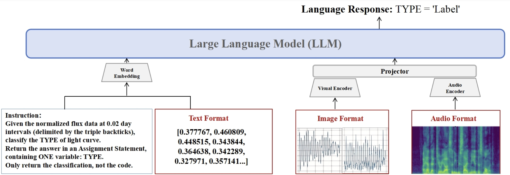
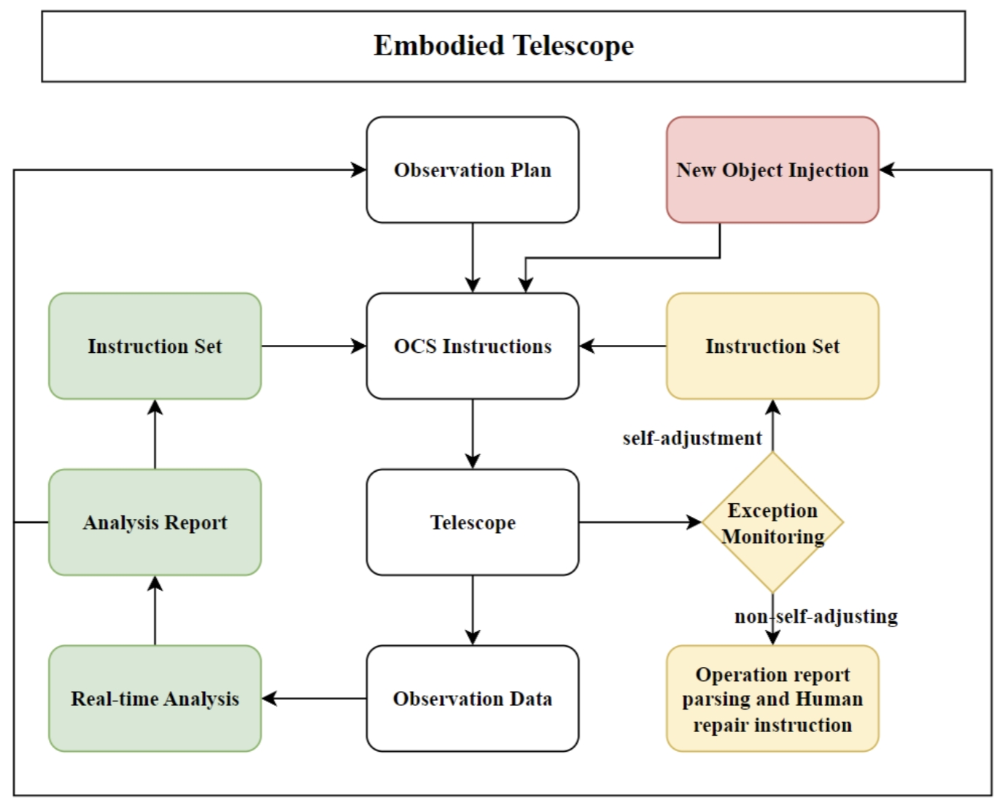
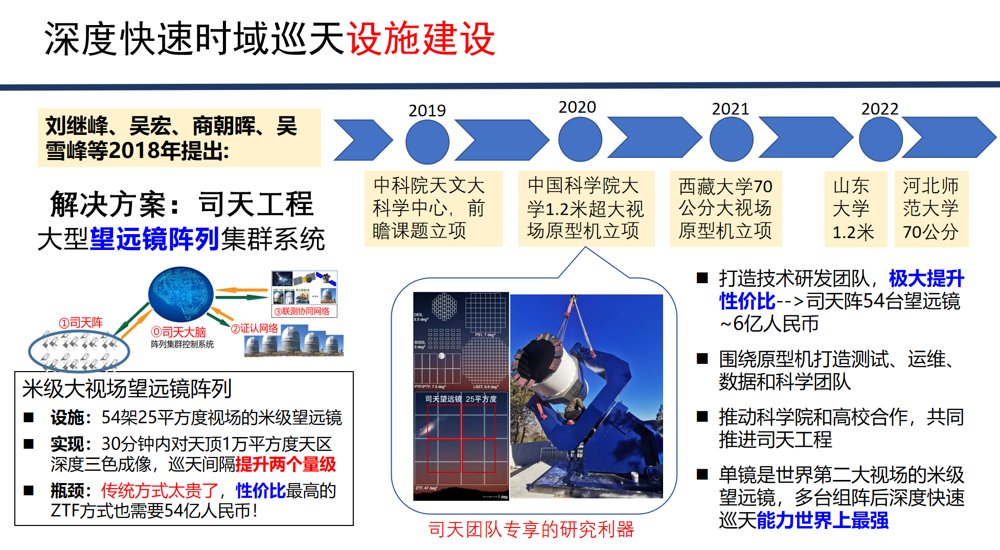
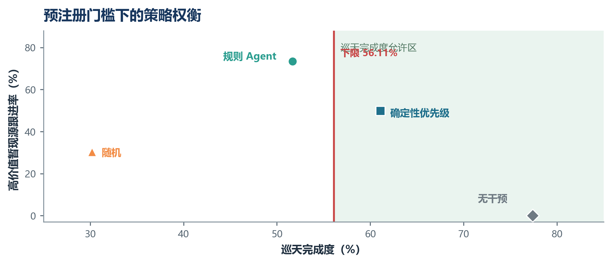

# StarWhisper 研究文档

[返回首页](../README.md) · 中文 · [English](research-en.md) · [技能安装](../skills/README.md)

这里整理各项工作的论文图表、实验结果和复现说明。代码和数据链接见[首页](../README.md#项目)。下列命令均从仓库根目录执行。

## 时间线

| 年 | 做了什么 | 代码 / 权重 |
| --- | --- | --- |
| 2023 | 仓库建立，天文语言模型 | [`LLM_Data/`](../LLM_Data)，[StarWhisper3](https://www.modelscope.cn/models/AstroYuYang/StarWhisper3) |
| 2024 | 光变分类、脉冲星、Telescope 预印本 | [`StarWhisper_LC/`](../StarWhisper_LC)，[Pulsar 代码](https://github.com/ACMISLab/StarWhisper-Pulsar) |
| 2025 | LC、Telescope 发表 | [`NGSS/`](../NGSS) |
| 2026 | 虚拟司天、Explore、技能包 | [SitianClaw](https://github.com/Yu-Yang-Li/SitianClaw)，[`skills/`](../skills/README.md) |

---

## 2023–2024 · 语言模型

StarWhisper 3 用于天文问答和代码生成。训练数据在 [`LLM_Data/`](../LLM_Data)，权重在魔搭 [AstroYuYang/StarWhisper3](https://www.modelscope.cn/models/AstroYuYang/StarWhisper3)。4.0 的科普和科研文本仍在整理，权重计划发布到魔搭。

---

## 2024–2025 · 光变曲线和脉冲星

[StarWhisper LC](https://spj.science.org/doi/10.34133/icomputing.0110) 使用 Kepler / K2 光变曲线进行变星分类，研究对象包括造父变星、RR Lyrae 和食双星。除 Conv1D–BiLSTM 和 Swin Transformer 外，论文还比较了较少依赖手工特征的 LLM / 多模态 / 音频模型，准确率大约 90%。预印本发布于 2024 年 4 月，论文于 2025 年 2 月 26 日发表于 *Intelligent Computing*。测试代码在 [`StarWhisper_LC/`](../StarWhisper_LC)。



2024 年 12 月，[StarWhisper-Pulsar](https://openreview.net/pdf?id=8SKgWpZiDL) 在 NeurIPS 2024 FM4Science workshop 报告，用多模态大模型做脉冲星候选分类。代码在 [ACMISLab/StarWhisper-Pulsar](https://github.com/ACMISLab/StarWhisper-Pulsar)。

---

## 2025 · StarWhisper Telescope

[论文](https://doi.org/10.1038/s44172-025-00520-4) 的预印本发布于 2024 年 12 月，论文于 2025 年 11 月 6 日发表于 *Communications Engineering*。观测智能体应用于近邻星系巡天（NGSS），涉及大约 10 台业余级望远镜。代码在 [`NGSS/`](../NGSS)。

观测过程中，临时目标、天气变化，以及跟踪、调焦、相机或穹顶故障都可能改变原定计划。系统需据此选择继续观测、插入目标、延后观测、安全暂停，或在恢复后重新规划。


<p align="center"><sub>既定计划、三类扰动、观测智能体、受约束行动与反馈。这是 Telescope 与 Explore 共用的判断结构，不是光学仿真，也不是真实硬件截图。</sub></p>



---

## 2026 · 虚拟司天

虚拟司天在 2026 年形成可运行的 SN Clock 系统。早期科学应用是超新星时钟，用于估计爆发时刻和筛选年轻超新星候选。公开说明见 [Virtual-GOTTA 地图](https://yu-yang-li.github.io/StarWhisper/virtual-gotta-map.html)。相关工作流的可安装技能见 [SitianClaw](https://github.com/Yu-Yang-Li/SitianClaw)，真假源分类样机在 [`GOTTA_Prototype/`](../GOTTA_Prototype)。

[`snclock/`](../snclock/README.md) 保存了一次历史预测：22 个 TNS 源在发现时刻的爆发后年龄估计，以 q16 / q50 / q84 三个分位表示，并按是否落在两天内分为两档。其中只有 2 个源在保守口径 q84 下也处于两天内。表的实际覆盖范围小于声明的筛选窗口，多数行的输入快照未留存；具体限制见数据说明。读表可用 [`starwhisper-snclock`](../skills/starwhisper-snclock/SKILL.md)：

```powershell
python .\skills\starwhisper-snclock\scripts\screen_snclock.py rank --top 10
python .\skills\starwhisper-snclock\scripts\screen_snclock.py audit
```

年龄估计不是光谱分类，表里的源也都已经在 TNS 上，不构成新发现。

司天计划在国内多个台站部署 54 台 1 米级大视场望远镜，大约每 30 分钟以三色覆盖 1 万平方度。StarWhisper 是司天数据分析与观测自动化的候选方案之一。



2026 年的其他工作包括：

- 兴隆全天相机 [`AllSky-Camera-XL/`](../AllSky-Camera-XL)：从天空图像生成新的观测序列
- 葵花卫星云量临近预报：私有仓库，使用 2022–2025 年历史夜次，该阶段工作于 2026 年 8 月结束，尚未用于业务预报
- 稀疏 ZTF / ATLAS 光变早期分类：[`Early Classification from Sparse Light Curves/`](../Early%20Classification%20from%20Sparse%20Light%20Curves)。已核对的结果可用 [`starwhisper-varlen`](../skills/starwhisper-varlen/SKILL.md) 查看；50 点预训练准确率不能作为 3–30 点设定的主结果
- 低信噪比恒星光谱：[`Low-SNR-Stellar-Spectra-as-Language/`](../Low-SNR-Stellar-Spectra-as-Language)，独立仓库 [Jared-web03](https://github.com/Jared-web03/Low-SNR-Stellar-Spectra-as-Language)

---

## 2026 · Explore

Telescope 用于巡天自动观测，Explore 则比较观测策略的收益、巡天完成度损失和安全暂停条件。

实验设定、动作集合和指标表见 [`explore/`](../explore/README.md)。`StarWhisper-Explore-v0.2` 使用合成环境：兴隆、单镜、一夜六个时隙。Agent 看不到未来扰动，也不能改变安全阈值。实验不模拟光学传播，不连接真实望远镜，环境代码尚未收录到本仓库。

比较对象预先确定为无干预、随机、确定性优先级和规则 Agent。正向结果要求三个种子均满足：没有主动安全违规，无效动作率 ≤ 1%，巡天完成度下降不超过 5 个百分点，并且高价值暂现源跟进率相对提高至少 20%，或科学效用提高至少 5%。

90 episode / 策略：

| 策略 | 平均科学效用 | 巡天完成度 | 高价值暂现源跟进率 | 无效动作 | 被拦截的危险尝试 |
| --- | ---: | ---: | ---: | ---: | ---: |
| 无干预 | 3.9343 | 77.41% | 0.00% | 0 | 122 |
| 随机 | 2.4027 | 30.19% | 30.37% | 18 | 72 |
| 确定性优先级 | 4.3289 | 61.11% | 49.81% | 0 | 0 |
| 规则 Agent | 4.3996 | 51.67% | 73.33% | 0 | 0 |



规则 Agent 相对确定性优先级，跟进率高 23.52 个百分点，效用大约高 1.6%，巡天完成度低 9.44 个百分点，超过预注册的 5 个百分点上限。三个种子的结果方向一致，已记录的复跑哈希一致。这是稳定负结果：暂现源跟进率提高，但巡天完成度的损失超出了允许范围。

下面的命令可重新计算判定；自备指标表可用 `--csv` 指定：

```powershell
python .\skills\starwhisper-explore\scripts\eval_gate.py bar
python .\skills\starwhisper-explore\scripts\eval_gate.py gate --agent rule_agent
```


<p align="center"><sub>先合成环境可复现，再脱敏日志校准，最后才是真实硬件影子运行（只建议、不执行）。当前公开结果停在第一级。</sub></p>

---

## 引用

```BibTeX
@article{wang2025starwhisper,
  title={StarWhisper Telescope: an AI framework for automating end-to-end astronomical observations},
  author={Wang, Cunshi and Zhang, Yu and Li, Yuyang and Hu, Xinjie and Mao, Yiming and Chen, Xunhao and Du, Pengliang and Wang, Rui and Wu, Ying and Yang, Hang and Li, Yansong and Wang, Beichuan and Mu, Haiyang and Chen, Xiaohan and He, Shunxuan and Mo, Hao and Zhang, Liyue and Du, Lin and Zhao, Yunning and Tian, Jianfeng and Ge, Liang and Mao, Yongna and Li, Shengming and Wang, Zheng and Lu, Xiaomeng and Zou, Jinhang and Huang, Yang and Sun, Ningchen and Zheng, Jie and He, Min and Bai, Yu and Jin, Junjie and Wu, Hong and Liu, Jifeng},
  journal={Communications Engineering},
  volume={4},
  pages={184},
  year={2025},
  doi={10.1038/s44172-025-00520-4},
  url={https://doi.org/10.1038/s44172-025-00520-4}
}
```

引用信息另见根目录的 [`CITATION.cff`](../CITATION.cff)。代码采用 Apache-2.0；`skills/` 中的他山改编部分采用 MIT，见 [`NOTICE.md`](../skills/NOTICE.md)。模型权重遵循各自许可证。
